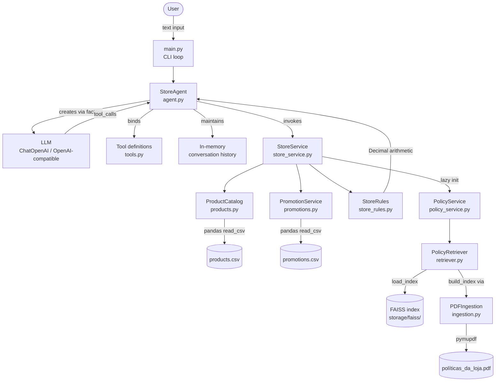

# Empório da Música — Conversational Customer Service Agent

> **Experimental / Educational project.** The store, company, and all associated data are entirely fictional and were created solely for learning and experimentation purposes. This project is not affiliated with any real business and is not intended for production use.

---

## Table of Contents

1. [Project Overview](#1-project-overview)
2. [Features](#2-features)
3. [Architecture](#3-architecture)
4. [Technology Stack](#4-technology-stack)
5. [Project Structure](#5-project-structure)
6. [Requirements](#6-requirements)
7. [Installation and Configuration](#7-installation-and-configuration)
8. [Running the Application](#8-running-the-application)
9. [Testing and Evaluation](#9-testing-and-evaluation)
10. [Technical Decisions](#10-technical-decisions)
11. [Limitations and Future Improvements](#11-limitations-and-future-improvements)
12. [Data and Privacy](#12-data-and-privacy)

---

## 1. Project Overview

This is an experimental and educational project that implements a CLI-based conversational agent simulating customer service for **Empório da Música**, a fictional musical instrument store. The store, its data, and all associated records are entirely made up and exist only to support the implementation. The project is not intended for production use.

The agent answers questions about products, prices, promotions, and store policies using a combination of structured data access and retrieval-augmented generation (RAG). It uses an LLM with tool calling to decide which data sources to consult per query. Structured data (product catalog, promotions, orders) is accessed deterministically through CSV-backed services. Unstructured data (store policy manual) is retrieved using a hybrid semantic and lexical search over a FAISS index built from a PDF document.

---

## 2. Features

The following capabilities are implemented and verified in the source code:

- **Product catalog search** — keyword and description-based search with stopword filtering, with optional availability filtering (active status + stock > 0).
- **Product details** — retrieval of full product information by ID, including specs, stock, and status.
- **Price and payment options** — deterministic calculation of base price, PIX discount (5%), and promotional prices; promotions and PIX discounts are not accumulated.
- **Promotion lookup** — identifies active promotions per product and calculates discounted prices.
- **Store policy retrieval** — hybrid RAG search over the PDF policy manual, returning relevant chunks with page references.
- **Combined queries** — the agent can call multiple tools in a single turn when the question involves more than one information source (e.g., product price and store hours).
- **Conversation history** — message history is maintained in-memory across turns within the same session, enabling contextual follow-up questions.
- **Out-of-scope handling** — the system prompt explicitly instructs the model to decline questions unrelated to the store.
- **Privacy enforcement** — `CustomerDirectory` loads only customer IDs; `OrderService` requires an authenticated customer ID and enforces that a customer can only access their own orders.

The following classes exist in the codebase but are **not exposed as agent tools**: `CustomerDirectory`, `OrderService`. They implement the data access logic but are not wired into `STORE_TOOLS` in the current version.

---

## 3. Architecture



### Component responsibilities

| Component | Responsibility |
|---|---|
| `main.py` | CLI loop — reads user input, calls `StoreAgent.ask()`, prints responses |
| `StoreAgent` | Orchestrates the LLM loop, dispatches tool calls, manages message history, formats price responses deterministically |
| `llm_factory.py` | Instantiates `ChatOpenAI` with configuration from environment variables; supports any OpenAI-compatible endpoint |
| `STORE_TOOLS` | Four LangChain tools bound to the LLM: `search_products`, `get_product_details`, `get_product_price_options`, `search_store_policy` |
| `StoreService` | Facade that aggregates catalog, promotions, rules, and policy access; initializes `PolicyService` lazily |
| `ProductCatalog` | Loads and queries the product CSV using pandas; token-based search with stopword filtering |
| `PromotionService` | Loads promotions CSV; returns active promotions and calculates discounted prices |
| `StoreRules` | Stateless class with deterministic business rules: PIX discount, shipping threshold, installment calculation |
| `PolicyService` | Wraps `PolicyRetriever`; loads the pre-built FAISS index on initialization |
| `PolicyRetriever` | Builds and queries the hybrid retrieval index (dense FAISS + TF-IDF word + TF-IDF char-ngram) with RRF fusion |
| `PDFIngestion` | Extracts text from the PDF using PyMuPDF and splits it into overlapping word-based chunks |

---

## 4. Technology Stack

| Category | Library | Version (lock) | Purpose |
|---|---|---|---|
| Language | Python | — | — |
| Agent framework | LangChain | 1.4.7 | Tool binding, message types, agent loop |
| LLM integration | langchain-openai | 1.7.3 | `ChatOpenAI` — OpenAI-compatible LLM client |
| Data processing | pandas | 3.1.0 | CSV loading and querying for all structured data |
| Data processing | numpy | 2.5.4 | Embedding array operations |
| Embeddings | sentence-transformers | 6.2.0 | `paraphrase-multilingual-MiniLM-L12-v2` for dense retrieval |
| Vector index | faiss-cpu | 1.15.1 | Inner-product index for semantic search |
| Lexical retrieval | scikit-learn | 1.9.1 | TF-IDF vectorizers for word and character n-gram search |
| PDF parsing | PyMuPDF | 2.0 | Text extraction from the policy PDF |
| Configuration | python-dotenv | 1.2.4 | `.env` file loading |
| Testing | pytest | 9.2.0 | Test runner |
| Testing | pytest-cov | 7.1.0 | Coverage reporting |

`fastapi` and `uvicorn` are listed in `requirements.txt` but no HTTP interface is implemented in the current codebase. They appear to be reserved for a future API layer.

---

## 5. Project Structure

```
emporio-ai-agent/
├── app/
│   ├── agent/
│   │   ├── agent.py          # StoreAgent — main loop, history, tool dispatch
│   │   ├── llm_factory.py    # LLM instantiation
│   │   ├── prompts.py        # System prompt
│   │   └── tools.py          # LangChain tool definitions (STORE_TOOLS)
│   ├── rag/
│   │   ├── ingestion.py      # PDF text extraction and chunking
│   │   └── retriever.py      # Hybrid FAISS + TF-IDF retrieval with RRF
│   ├── services/
│   │   ├── policy_service.py # Wraps PolicyRetriever for agent use
│   │   ├── store_rules.py    # Deterministic business rules
│   │   └── store_service.py  # Facade aggregating all services
│   ├── tools/
│   │   ├── customers.py      # CustomerDirectory (ID-only, not exposed as tool)
│   │   ├── orders.py         # OrderService (not exposed as tool)
│   │   ├── products.py       # ProductCatalog
│   │   └── promotions.py     # PromotionService
│   ├── config.py             # Environment variables and data file paths
│   └── main.py               # CLI entry point
├── data/
│   └── private/              # CSV datasets and PDF policy manual
├── storage/
│   └── faiss/                # Pre-built FAISS index and chunk metadata
├── tests/                    # Automated tests and evaluation scripts
├── examples/                 # Conversation example files (currently empty)
├── .env.example              # Environment variable template
├── requirements.txt          # Direct dependencies
└── requirements-lock.txt     # Pinned full dependency tree
```

---

## 6. Requirements

- **Python 3.10+** — required for the `X | Y` union type syntax used throughout the codebase.
- An **OpenAI-compatible LLM API** — any provider that supports the OpenAI chat completions API (OpenAI, Azure OpenAI, Groq, local models via LM Studio or Ollama with an OpenAI-compatible endpoint, etc.).
- The data files described in [Section 12](#12-data-and-privacy).

No database server or external services beyond the LLM API are required.

---

## 7. Installation and Configuration

### Clone the repository

```bash
git clone https://github.com/cauaenzo/emporio-agent.git
cd emporio-ai-agent
```

### Create and activate a virtual environment

```bash
python -m venv venv
```

**Windows:**
```bash
venv\Scripts\activate
```

**macOS / Linux:**
```bash
source venv/bin/activate
```

### Install dependencies

For a reproducible installation using the pinned dependency tree:

```bash
pip install -r requirements-lock.txt
```

For a standard installation with the latest compatible versions:

```bash
pip install -r requirements.txt
```

The `requirements-lock.txt` file pins every dependency to the exact versions used during development and is the recommended choice for consistent environments.

### Configure environment variables

Copy `.env.example` to `.env` and fill in the required values:

```bash
cp .env.example .env
```

| Variable | Required | Description |
|---|---|---|
| `LLM_PROVIDER` | Yes | Must be `openai-compatible`. Other providers are not yet implemented. |
| `LLM_API_KEY` | Yes | API key for the LLM provider. |
| `LLM_BASE_URL` | No | Custom base URL for OpenAI-compatible endpoints. Leave empty when using OpenAI directly. |
| `LLM_MODEL` | Yes | Model name (e.g., `gpt-4o`, `llama-3.1-8b-instruct`). |
| `LLM_TEMPERATURE` | No | Sampling temperature. Defaults to `0`. |
| `APP_ENV` | No | Application environment. Defaults to `development`. |
| `APP_DEBUG` | No | Debug mode flag. Defaults to `true`. |
| `DATA_DIR` | No | Directory containing the CSV and PDF data files. Defaults to `data/private`. |
| `VECTOR_STORE_DIR` | No | Directory containing the FAISS index files. Defaults to `storage/faiss`. |

### Data files

The application expects the following files inside `DATA_DIR` (`data/private` by default):

```
data/private/
├── desafio_tecnico_ai_eng - products.csv
├── desafio_tecnico_ai_eng - categories.csv
├── desafio_tecnico_ai_eng - customers.csv
├── desafio_tecnico_ai_eng - orders.csv
├── desafio_tecnico_ai_eng - order_items.csv
├── desafio_tecnico_ai_eng - promotions.csv
└── políticas_da_loja.pdf
```

These files are included in the repository. The datasets were created for this experimental project. The business is fictional, and all records (customer names, phone numbers, emails, orders) are synthetic — generated to support the implementation and not based on real individuals or transactions. See [Section 12](#12-data-and-privacy) for details.

### FAISS index

A pre-built FAISS index is included in `storage/faiss/`. No additional setup is required unless the index needs to be rebuilt after replacing the PDF:

```python
from app.rag.retriever import PolicyRetriever

retriever = PolicyRetriever()
retriever.build_index()
retriever.save_index()
```

---

## 8. Running the Application

```bash
python -m app.main
```

The agent starts a CLI loop:

```
=======================================================
       EMPÓRIO DA MÚSICA - ASSISTENTE VIRTUAL
=======================================================
Digite sua pergunta ou 'sair' para encerrar.

Assistente inicializado com sucesso.

Você: 
```

- Type a message and press Enter to send.
- The agent responds, then waits for the next input.
- Conversation history is maintained across turns within the session.
- Type `sair`, `exit`, or `quit` to end the session.

The `PolicyService` (RAG) is initialized lazily — the FAISS index is loaded only on the first policy-related query, not at startup.

---

## 9. Testing and Evaluation

### Run the automated test suite

```bash
pytest
```

With coverage:

```bash
pytest --cov=app --cov-report=term-missing
```

### Test organization

| File | Type | What it covers |
|---|---|---|
| `test_products.py` | Unit | `ProductCatalog` — search, availability filtering, price lookup, edge cases |
| `test_promotions.py` | Unit | `PromotionService` — active promotions, discount calculation, invalid inputs |
| `test_store_rules.py` | Unit | `StoreRules` — PIX discount, shipping threshold, installment calculation |
| `test_orders.py` | Integration | `OrderService` — data loading, customer isolation, access control |
| `test_store_service.py` | Integration | `StoreService` — facade behavior, lazy policy initialization |
| `test_policy_service.py` | Integration | `PolicyService` + FAISS index — loads index, retrieves relevant policy chunks |
| `test_retrieval.py` | Integration | `PolicyRetriever` — parametrized queries against expected policy content |
| `test_agent.py` | Unit (mocked LLM) | `StoreAgent` — tool dispatch, price formatting, history, error handling, multi-tool calls |
| `test_llm_config.py` | Unit | `config.py` — environment variable validation |

Tests in `test_orders.py`, `test_store_service.py`, `test_policy_service.py`, and `test_retrieval.py` require the data files to be present at the configured `DATA_DIR`.

`test_agent.py` uses a fake LLM (`FakeLLM`) and fake tools to isolate agent logic from the actual LLM and data layer.

### Evaluation script

```bash
python -m tests.evaluate_agent
```

This script runs 8 manually defined scenarios against a live `StoreAgent` instance, requiring a configured `.env` with valid LLM credentials. Scenarios include:

- Product search and catalog queries
- Multi-turn conversation continuity
- Non-existent product handling
- Promotions and discount stacking
- Policy manual queries (hours, returns, shipping, accessories)
- Shipping threshold edge cases
- Combined product + policy queries
- Out-of-scope question handling

The evaluation script prints responses but does not produce a numeric score or automated pass/fail verdict. Results require manual review.

---

## 10. Technical Decisions

### Tool calling over a single prompt

The agent delegates decisions to the LLM through LangChain's tool binding. Rather than routing queries through conditional logic, the model decides which tools to call based on the question and the system prompt. This allows multi-tool calls in a single turn for combined queries.

### Deterministic business rules outside the LLM

Price calculations, PIX discounts, shipping fees, and installment amounts are computed in `StoreRules` using Python's `Decimal` type for precision. The system prompt explicitly prohibits the model from calculating prices manually. This ensures numerical accuracy regardless of model behavior.

### Hybrid retrieval with RRF

`PolicyRetriever` combines three rankings per query — dense semantic search (FAISS with `paraphrase-multilingual-MiniLM-L12-v2` embeddings), word-level TF-IDF, and character n-gram TF-IDF — fused via Reciprocal Rank Fusion. This improves recall for both semantic and exact-term queries against a Portuguese-language policy document.

### Structured data via pandas, not RAG

Product, promotion, and order data are stored in CSV files and queried directly using pandas. This was preferred over RAG for structured data because it allows precise filtering, exact price lookups, and deterministic availability checks that semantic search cannot reliably provide.

### CSV data loading at startup

`ProductCatalog` and `PromotionService` load their respective CSVs at instantiation. `StoreService` initializes them eagerly when the agent starts. `PolicyService` is initialized lazily — the FAISS index is loaded only on the first policy query.

### In-memory conversation history

The agent appends every `HumanMessage`, `AIMessage`, and `ToolMessage` to a list stored in the `StoreAgent` instance. The full history is passed to the LLM on every turn. History is not persisted between sessions.

### LLM provider abstraction

`llm_factory.py` reads `LLM_PROVIDER` from the environment and returns a `ChatOpenAI` instance with a configurable `base_url`. This allows the application to work with any OpenAI-compatible endpoint without code changes. Only `openai-compatible` is implemented; other providers would require additional factory branches.

### Privacy by design in data access

`CustomerDirectory` intentionally loads only the `customer_id` column, discarding all personal information at read time. `OrderService` always requires a verified `authenticated_customer_id` parameter and enforces ownership at the query level. The system prompt also instructs the model not to reveal customer data or claim to perform write operations.

---

## 11. Limitations and Future Improvements

### Confirmed limitations

- **Static CSV data** — the application reads CSV snapshots at startup. There is no live database connection. Data changes require restarting the application.
- **No authentication** — `OrderService` and `CustomerDirectory` implement the data-access logic for order queries, but neither is exposed as an agent tool. There is no mechanism to authenticate a customer during a conversation, so order lookups cannot be safely offered to users in the current version.
- **In-memory history only** — conversation history is lost when the process ends. There is no persistence layer.
- **No HTTP API** — the application runs as a CLI only. `fastapi` and `uvicorn` are listed as dependencies but not used.
- **Single LLM provider type** — only `openai-compatible` providers are supported. Adding a different provider requires code changes in `llm_factory.py`.
- **PDF policy retrieval ambiguity** — if the policy manual does not explicitly address a question, the system prompt instructs the model to report the gap rather than infer an answer. This is correct behavior, but it means that ambiguous or incomplete policy documents result in incomplete answers.
- **Product description quality** — product descriptions in the CSV may contain qualitative claims. The system prompt instructs the model not to amplify these, but the underlying data is not verified for accuracy.

### Possible improvements

- Expose `OrderService` as an agent tool once a customer authentication mechanism is in place.
- Add a persistence layer for conversation history (e.g., SQLite, Redis).
- Implement an HTTP API using the already-listed FastAPI dependency.
- Add support for additional LLM providers in `llm_factory.py`.
- Replace CSV snapshots with a queryable data store for live inventory updates.
- Add a scoring mechanism to the evaluation script for automated regression testing.

---

## 12. Data and Privacy

### Required files

The application reads six CSV files and one PDF from `DATA_DIR` (default: `data/private/`):

| File | Contents |
|---|---|
| `desafio_tecnico_ai_eng - products.csv` | Product catalog: 65 products across multiple instrument categories |
| `desafio_tecnico_ai_eng - categories.csv` | Product category definitions |
| `desafio_tecnico_ai_eng - customers.csv` | Customer records including names, phone numbers, and email addresses |
| `desafio_tecnico_ai_eng - orders.csv` | Order history: 20 orders with status, payment method, and tracking codes |
| `desafio_tecnico_ai_eng - order_items.csv` | Line items linking orders to products |
| `desafio_tecnico_ai_eng - promotions.csv` | 25 promotion records, 4 of which are active |
| `políticas_da_loja.pdf` | Store policy manual used for RAG |

### Repository inclusion

These files are versioned in this repository under `data/private/`. The business represented is entirely fictional, and all datasets are synthetic — created specifically for this experimental and educational project. No real individuals, companies, or transactions are represented.

### FAISS index

The pre-built index (`storage/faiss/policies.index` and `storage/faiss/chunks.json`) is also versioned and generated exclusively from `políticas_da_loja.pdf`.

### How data is loaded

`app/config.py` resolves `DATA_DIR` from the `DATA_DIR` environment variable (defaulting to `data/private`) and constructs the full path for each file. To use a different data directory, set `DATA_DIR` in `.env` before starting the application.
---

## References

- [An Analysis of Fusion Functions for Hybrid Retrieval (2022)](https://arxiv.org/pdf/2210.11934)
- [Dense vs Sparse Retrieval: Mastering FAISS, BM25, and Hybrid Search](https://dev.to/fagundesv/dense-vs-sparse-retrieval-mastering-faiss-bm25-and-hybrid-search-4kb1)